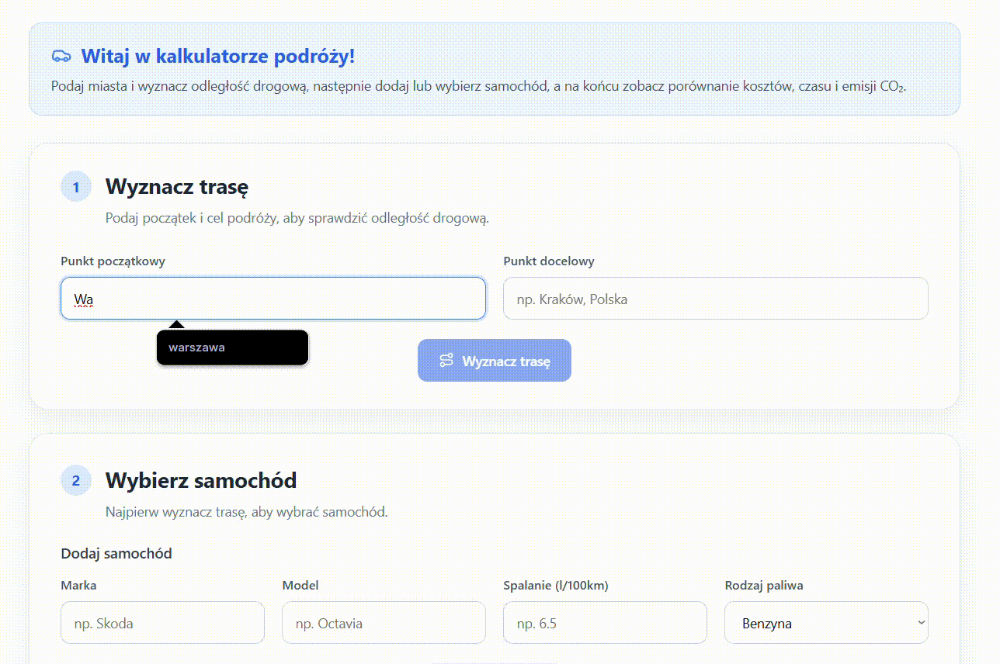

# Travel Cost & CO2 Emission Calculator

To aplikacja webowa służąca do kalkulacji i porównywania kosztów oraz wpływu na środowisko podróży międzymiastowych. Dostępne rodzaju transportu to samochód z podziałem ceny na liczbę pasażerów oraz pociąg i flixbus.

---

## Funkcjonalności
- **Zarządzanie pojazdami (CRUD):** Dodawanie, edytowanie, usuwanie i wybór własnego samochodu (z uwzględnieniem marki, modelu, rodzaju paliwa: benzyna/diesel/lpg oraz średniego spalania l/100km).
- **Kalkulator trasy i geokodowanie:** Dynamiczne wyszukiwanie lokalizacji za pomocą otwartego API Nominatim (OpenStreetMap).
- **Porównanie środków transportu:** Zestawienie kosztów podróży samochodem (z podziałem na liczbę pasażerów), pociągiem oraz autobusem (Flixbus).
- **Ślad węglowy (Eco-Score):** Wyliczanie emisji CO₂ dla każdej opcji transportu z wyróżnieniem ekologicznych alternatyw (np. zielony listek dla pociągu).

---

## Opis Techniczny
- **Backend:** Node.js, TypeScript, Express.js, wbudowana baza w pamięci (Memory DB), dedykowane serwisy obliczeniowe dla zużycia paliwa i emisji CO₂, w obecnej wersji ceny biletów oraz czas podróży dla pociągu oraz flixbusa są tylko oszacowane. W dalszej czesci projektu korzystanie z płatnego API byłoby wdrożone.
- **Frontend:** React, Vite, TypeScript, Tailwind CSS do nowoczesnego stylowania, `lucide-react` do czytelnych ikon.
- **API zewnętrzne:** Nominatim OpenStreetMap API (geokodowanie miast).

---

## Instrukcja Uruchomienia Krok po Kroku

### 1. Setup
Przed uruchomieniem należy upewnić się, czy **Node.js (w wersji v24 lub nowszej)** oraz narzędzie **Git** jest zainstalowane.

### 2. Sklonuj repozytorium
```bash
git clone [https://github.com/Klaudia-Aleksiejew/trip-cost-calculator](https://github.com/Klaudia-Aleksiejew/trip-cost-calculator)
cd trip-cost-calculator
```

### 3. Uruchom dwa osobne terminale 

1 terminal - do uruchomienia backendu
```bash
  cd backend
  npm install
  npm run dev
```

2 terminal - do uruchomienia forntendu
```bash
  cd frontend
  npm install
  npm run dev
```

* W razie gdyby wystąpił błąd typu
```bash
npm.ps1 cannot be loaded because running scripts is disabled on this system.

#należy użyć komendy poniżej (pozwala na bezpieczne uruchamianie skryptow dla danej instancji terminala
Set-ExecutionPolicy RemoteSigned -Scope Process
```
### 4. Uruchomienie strony

Po uruchomieniu komend w terminalu dotyczącym frontendu wyświetli się adres lokalny - zazwyczaj "http://localhost:5173". Otwórz go w swojej przeglądarce internetowej (przytrzymaj ctrl + naciśnij lewy przycisk myszki na linku)

---

## Wykorzystanie Narzędzi AI
Podczas realizacji projektu aktywnie korzystano z asystentów sztucznej inteligencji w celach architektonicznych, implementacyjnych i optymalizacyjnych:
- **GitHub Copilot (w środowisku VS Code):** Wykorzystany jako asystent kodowania (*coding assistant*) wspierający pisanie struktur w TypeScript, generowanie kodu komponentów interfejsu w React oraz iteracyjne rozwiązywanie problemów z typowaniem i stylami Tailwind CSS.
- **Model językowy (AI Collaborator):** Użyty do zaprojektowania spójnej architektury full-stack, stworzenia logiki biznesowej dla algorytmów obliczeniowych (emisje CO₂ dla różnych rodzajów paliw) oraz przygotowania precyzyjnych instrukcji wdrożeniowych i struktury dokumentacji projektu.

---

## Demo aplikacji


